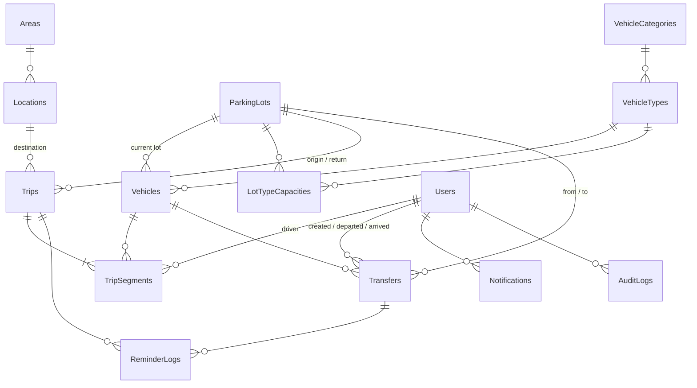

# Database Design

**Version:** 0.3 · **Date:** 2026-11-27 · **Status:** Approved (D-043). **Implemented:** all tables (migrations `InitialCreate`, `MasterData`, `Trips`, `RemoveStaffLots`, `TransfersAndNotifications`). StaffLots was removed by D-047.
**Database:** a new SQL Server database for this app only (D-029), SQL Server 2019 Express on the server (10 GB limit). Schema created and changed only by EF Core code-first migrations, applied at API startup (D-030).
**Sources:** `REQUIREMENTS.md` v1.1, `PROJECT_DECISIONS.md` up to D-042, `ARCHITECTURE.md` v0.3.

Every item is approved: from a requirement or decision, or proposed by me and accepted by the owner on 2026-11-26 (D-043).

---

## 1. Conventions

| Topic | Rule |
|---|---|
| Names | Tables plural PascalCase (`Vehicles`); columns PascalCase; keys `Id`; foreign keys `<Entity>Id` |
| Keys | `int IDENTITY` primary keys. External references (QR codes, file names) never expose them |
| Times | `datetime2(3)`, always UTC, column names end in `Utc` (BR-01). Lot opening hours: `time(0)`, local GST |
| Enums | Stored as strings (`varchar(30)`) so the data reads clearly in SQL and reports |
| Text | `nvarchar` for names and free text (Arabic-ready); `varchar` for codes, tokens and file names |
| Deletion | Nothing is ever deleted (BR-08). Rows are deactivated (`IsActive = 0`). Every foreign key is `ON DELETE NO ACTION`. Exception: `ErrorLogs` (30-day retention) |
| Concurrency | `RowVersion rowversion` on Users, Vehicles, ParkingLots, Trips, Transfers, AppSettings. A lost race returns `409 CONCURRENCY_CONFLICT` |
| Timestamps | Master-data tables have `CreatedAtUtc` and `UpdatedAtUtc`, set by an EF interceptor. Who changed what is in `AuditLogs` |
| Collation | Server default, case-insensitive. Login IDs and registration keys are additionally stored upper-case |

## 2. Diagram

## 3. Tables

### 3.1 Users (admins and staff, D-007, D-020)

| Column | Type | Null | Notes |
|---|---|---|---|
| Id | int identity | | PK |
| LoginId | varchar(20) | | Unique. `DM2600042` (staff, D-011) or `ADM2600001` (admin, D-037). Stored upper-case |
| Role | varchar(30) | | `Admin` or `Staff` |
| FullName | nvarchar(100) | | |
| Mobile | varchar(20) | | E.164 style, e.g. `+971501234567` |
| Email | nvarchar(256) | ✓ | Optional (P-01) |
| LicenceNumber | nvarchar(50) | ✓ | Driving licence. Required for staff, null for admins (D-020) |
| PhotoFileName | varchar(40) | ✓ | API-generated name only (D-034) |
| Password | nvarchar(128) | | Plain text, by owner decision (D-051). Compared in code, case-sensitive. Was `PasswordHash` (PBKDF2) until migration `PlainTextPasswords` |
| SecurityStamp | char(32) | | Rotated on deactivate, password reset or change; every session checks it (AUTH-07) |
| FailedLoginCount | int | | Reset on success |
| LockoutEndUtc | datetime2(3) | ✓ | 5 failures → now + 15 min (AUTH-08) |
| IsActive | bit | | |
| CreatedAtUtc, UpdatedAtUtc | datetime2(3) | | |
| RowVersion | rowversion | | |

Check: `Role = 'Staff'` ⇒ `LicenceNumber IS NOT NULL`.

### 3.2 IdSequences (ID generation, D-011, D-037)

| Column | Type | Notes |
|---|---|---|
| Role | varchar(30) | PK: `Staff`, `Admin` |
| LastNumber | int | Incremented inside the create-user transaction with `UPDLOCK`. Never reset, never reused |

ID = prefix + last two digits of the **GST** year at creation + `LastNumber` padded to 5 digits. Staff prefix from `AppSettings.StaffIdPrefix`; admin prefix fixed `ADM`. Seeded rows: both roles at 0. A full 5-digit range (99,999) per role is ample.

### 3.3 ~~StaffLots~~: removed (D-047, migration `RemoveStaffLots`). Kept below for history only

| Column | Type | Notes |
|---|---|---|
| UserId | int | PK part, FK Users (staff only) |
| LotId | int | PK part, FK ParkingLots |

A staff member needs at least one lot (checked by the API).

### 3.4 VehicleCategories and VehicleTypes (VEH-01)

| Table | Columns |
|---|---|
| VehicleCategories | Id, Name nvarchar(60) **unique**, IsActive, timestamps |
| VehicleTypes | Id, CategoryId (FK), Name nvarchar(60), IsActive, timestamps. **Unique** (CategoryId, Name) |

### 3.5 Vehicles (VEH-02..05, QR-01)

| Column | Type | Null | Notes |
|---|---|---|---|
| Id | int identity | | PK |
| RegistrationNumber | nvarchar(30) | | As displayed, e.g. `D 01423` |
| RegistrationKey | varchar(30) | | **Unique.** Upper-case, spaces and dashes removed; used for typed lookup (QR-05) |
| VehicleTypeId | int | | FK |
| Brand | nvarchar(60) | | |
| Model | nvarchar(60) | | |
| Colour | nvarchar(30) | | |
| PhotoFileName | varchar(40) | ✓ | D-034 |
| QrToken | char(22) | | **Unique.** 16 random bytes, base64url. Holds no data (QR-01); reprints reuse it (QR-04) |
| Status | varchar(30) | | `Available`, `Active`, `Inactive`, `UnderMaintenance` (VEH-03) |
| CurrentLotId | int | ✓ | FK ParkingLots. See §4 |
| CreatedAtUtc, UpdatedAtUtc, RowVersion | | | |

### 3.6 ParkingLots and LotTypeCapacities (LOT-01..07)

| Column (ParkingLots) | Type | Null | Notes |
|---|---|---|---|
| Id | int identity | | |
| Code | varchar(20) | | **Unique** |
| Name | nvarchar(100) | | |
| Address | nvarchar(300) | | |
| ~~Latitude, Longitude~~ | — | | **Removed** by migration `RemoveLotCoordinates` (D-056: no map in v1) |
| ContactName | nvarchar(100) | | |
| ContactNumber | varchar(20) | | |
| OpensAt, ClosesAt | time(0) | ✓ | Information only (LOT-05) |
| LotType | varchar(30) | | `Open`, `Underground`, `Other` |
| TotalCapacity | int | | ≥ 0 |
| BaselineOccupied | int | | Spaces taken by vehicles outside the system (LOT-02), ≥ 0 |
| IsActive | bit | | Inactive lots can't start, receive returns or transfers (LOT-07) |
| CreatedAtUtc, UpdatedAtUtc, RowVersion | | | |

| Column (LotTypeCapacities) | Type | Notes |
|---|---|---|
| LotId, VehicleTypeId | int | PK (both) |
| Capacity | int | ≥ 0 |
| BaselineOccupied | int | ≥ 0 (P-09) |

### 3.7 Areas and Locations (DST-01)

| Table | Columns |
|---|---|
| Areas | Id, Name nvarchar(100) **unique**, IsActive, timestamps |
| Locations | Id, AreaId (FK), Name nvarchar(150), IsActive, timestamps. **Unique** (AreaId, Name) |

### 3.8 Trips (TRP)

| Column | Type | Null | Notes |
|---|---|---|---|
| Id | int identity | | |
| Status | varchar(30) | | `Active`, `Ended`, `Cancelled` (BR-10) |
| OriginLotId | int | | FK |
| DestinationLocationId | int | | FK (DST-02) |
| CurrentStaffId | int | | FK Users. Changes on hand-over |
| CurrentVehicleId | int | | FK Vehicles. Changes on vehicle swap |
| StartedAtUtc | datetime2(3) | | Server time |
| EndedAtUtc | datetime2(3) | ✓ | Set on end or cancel |
| ReturnLotId | int | ✓ | End: the return lot. Cancel: the lot where the vehicle was left, or null = Not at a lot |
| CancelCategory | varchar(30) | ✓ | `Driver`, `Vehicle`, `Technical`, `Other` (TRP-08) |
| CancelNote | nvarchar(500) | ✓ | |
| NextReminderAtUtc | datetime2(3) | ✓ | Start + reminder delay; then +30 min per reminder; null once closed |
| ReminderCount | int | | |
| RowVersion | rowversion | | |

Indexes:
- **Unique filtered** `(CurrentStaffId) WHERE Status = 'Active'`: one active trip per staff (BR-02).
- **Unique filtered** `(CurrentVehicleId) WHERE Status = 'Active'`: one active trip per vehicle.
- `(Status, NextReminderAtUtc)` for the reminder job; `(StartedAtUtc)` for reports.

### 3.9 TripSegments (D-012, D-020)

| Column | Type | Null | Notes |
|---|---|---|---|
| Id | int identity | | |
| TripId | int | | FK |
| Seq | int | | 1, 2, 3…; **unique** (TripId, Seq) |
| Kind | varchar(30) | | `Start`, `VehicleSwap`, `HandOver` |
| StaffId | int | | FK Users, the driver for this segment |
| VehicleId | int | | FK Vehicles |
| StartedAtUtc | datetime2(3) | | |
| EndedAtUtc | datetime2(3) | ✓ | Null on the open segment |
| Reason | nvarchar(500) | ✓ | Required for swap and hand-over (P-03) |
| SignatureFileName | varchar(40) | ✓ | Start segment only (TRP-01; none on hand-over, D-041) |
| OutgoingVehicleLotId | int | ✓ | Vehicle swap: where the previous vehicle was left; null = Not at a lot |

Exactly one open segment (`EndedAtUtc IS NULL`) per active trip; enforced by the API inside the trip transaction. Staff and vehicle hours = sum of their segment durations (BR-06).

### 3.10 Transfers (TRF)

| Column | Type | Null | Notes |
|---|---|---|---|
| Id | int identity | | |
| Status | varchar(30) | | `PendingDeparture`, `InTransit`, `Completed`, `Cancelled` |
| VehicleId | int | | FK |
| FromLotId, ToLotId | int | | FK; must differ |
| Note | nvarchar(500) | ✓ | |
| CreatedByUserId, CreatedAtUtc | | | Admin |
| DepartedByUserId, DepartedAtUtc | | ✓ | Any staff member; **this person drives** (D-020, D-047) |
| ArrivedByUserId, ArrivedAtUtc | | ✓ | Any staff |
| CancelledByUserId, CancelledAtUtc | | ✓ | Admin, only before departure (TRF-06) |
| NextReminderAtUtc, ReminderCount | | | Same rule as trips while InTransit (TRF-07) |
| RowVersion | rowversion | | |

Indexes:
- **Unique filtered** `(VehicleId) WHERE Status IN ('PendingDeparture','InTransit')`: one open transfer per vehicle.
- `(DepartedByUserId) WHERE Status = 'InTransit'`: used for the D-026 check.

Transfer hours (TRF-05) = `ArrivedAtUtc − DepartedAtUtc`, for the driver (DepartedBy) and the vehicle.

### 3.11 ReminderLogs (TRP-06, A-04)

| Column | Type | Notes |
|---|---|---|
| Id | int identity | |
| TripId / TransferId | int, null | Exactly one is set (check constraint) |
| RecipientUserId | int | Staff member or admin |
| ReminderNumber | int | 1, 2, 3… |
| SentAtUtc | datetime2(3) | |

### 3.12 Notifications (NTF-03, D-039)

| Column | Type | Notes |
|---|---|---|
| Id | int identity | |
| UserId | int | Recipient |
| Type | varchar(40) | e.g. `TripReminder`, `TripOverdueAdmin`, `TransferAwaitingDeparture`, `TransferAwaitingArrival`, `TripCancelled` |
| Title | nvarchar(120) | |
| Body | nvarchar(500) | |
| TargetType, TargetId | varchar(30), int | What tapping opens (`Trip`, `Transfer`) |
| CreatedAtUtc | datetime2(3) | |
| ReadAtUtc | datetime2(3), null | |

Index `(UserId, ReadAtUtc, CreatedAtUtc)`.

### 3.13 AuditLogs (AUD-01)

| Column | Type | Notes |
|---|---|---|
| Id | bigint identity | |
| AtUtc | datetime2(3) | |
| UserId | int | Admin who acted |
| Action | varchar(40) | `Create`, `Update`, `Delete` (join rows, e.g. a removed per-type lot capacity), `Deactivate`, `Reactivate`, `StatusChange`, `LocationResolve`, `PasswordReset` (another account), `PasswordChange` (own); transfers add their own actions in M4 |
| EntityType | varchar(40) | e.g. `Vehicle` |
| EntityId | int | |
| BeforeJson, AfterJson | nvarchar(max), null | Changed fields only. Passwords and security stamps are never written |

Written by an EF `SaveChanges` interceptor for admin changes. Indexes on `(AtUtc)`, `(UserId)`, `(EntityType, EntityId)`. Kept forever (small).

### 3.14 AppSettings (SET-01)

One row (`Id = 1`, check constraint).

| Column | Type | Notes |
|---|---|---|
| StaffIdPrefix | varchar(5) | Default `DM`; letters only; never `ADM` (D-037) |
| ReminderDelayMinutes | int | First reminder after start / departure. Default **120** (D-043), admin changes it |
| ReminderRepeatMinutes | int | 30 (D-009) |
| RowVersion | rowversion | |

### 3.15 ErrorLogs (D-032, ARCHITECTURE §6)

| Column | Type | Notes |
|---|---|---|
| Id | bigint identity | |
| AtUtc | datetime2(3) | |
| TraceId | varchar(64) | Same value the app receives |
| Level | varchar(20) | `Warning` (4xx), `Error` (5xx), `Critical` |
| StatusCode | int | |
| Code | varchar(50) | e.g. `DATABASE_UNAVAILABLE` |
| Method, Path | varchar(10), nvarchar(400) | Query string without values of sensitive keys |
| UserId, Role | int null, varchar(30) null | |
| ExceptionType | nvarchar(300) null | |
| Message | nvarchar(2000) | |
| StackTrace, InnerException | nvarchar(max) null | 5xx only |
| ClientIp | varchar(45) | |
| AppVersion | varchar(30) null | From the app's request header |

Index `(AtUtc)` for the 30-day retention job and filtering.

## 4. Vehicle location and occupancy rules

One column, `Vehicles.CurrentLotId`, drives both "where is it" and lot occupancy.

| Event | Status | CurrentLotId |
|---|---|---|
| Created | Available (or admin's choice) | The lot chosen on the form |
| Trip start | `Active` | `null` (out of the lot) |
| Vehicle swap: new vehicle | `Active` | `null` |
| Vehicle swap: old vehicle | `Available` (D-043); admins notified | Lot picked by staff, or `null` = Not at a lot |
| Trip end | `Available` | Return lot |
| Trip cancel | `Available` (D-043); admins notified | Lot picked by staff, or `null` |
| Transfer created | Unchanged | Unchanged |
| Transfer departure | `Active` | **Unchanged** (still counted at the origin, TRF-03) |
| Transfer arrival | `Available` | Destination lot |
| Admin resolves "Not at a lot" | Admin's choice | Lot chosen by admin |

- **Not at a lot** = `CurrentLotId IS NULL AND Status <> 'Active'`.
- **Occupied** (BR-05) for a lot = `BaselineOccupied` + vehicles with `CurrentLotId = lot`. Per type: the type's baseline + its vehicles there. Includes Inactive and Under-maintenance vehicles parked there, and vehicles in an in-transit transfer from this lot.
- **Available** = capacity − occupied (may go negative: full lots warn, never block, BR-09).
- Types with no capacity row at a lot: occupied is shown, no per-type limit. Total capacity is independent of the per-type figures (no sum check, D-043).

## 5. Rule enforcement

| Rule | Where |
|---|---|
| One active trip per staff, per vehicle (BR-02) | Filtered unique indexes + API check |
| Driving a transfer counts as the active trip (D-026) | API check inside the trip/transfer transaction, under `sp_getapplock` on the staff member |
| Vehicle Available, at the origin lot, no open transfer (BR-04) | API check, vehicle row locked (`UPDLOCK`) in the transaction; RowVersion as the final guard |
| One open transfer per vehicle | Filtered unique index |
| Start only from active lots (BR-03 as changed by D-047, LOT-07) | API |
| Unique registration, login ID, lot code, QR token, names | Unique indexes → `409 DUPLICATE_VALUE` with the field name |
| Records never deleted (BR-08) | No delete endpoints; `NO ACTION` foreign keys |
| Status change only when not on a trip or transfer (D-043 Q4) | API → `409 STATUS_CHANGE_NOT_ALLOWED` |

## 6. Seed data (first migration / startup)

- `AppSettings` row 1 (`DM`, delay 120, repeat 30).
- `IdSequences`: `Staff` = 0, `Admin` = 0.
- First admin, only when `Users` is empty, from server environment variables `Seed__FirstAdmin__FullName`, `...__Mobile`, `...__Password` (AUTH-06). Nothing secret in migrations.

## 7. Questions answered (D-043, owner accepted all)

| # | Question | Answer |
|---|---|---|
| Q1 | On **cancel** (and for the old vehicle on a **vehicle swap**) the requirement says "the vehicle's status doesn't change; the admin decides". The vehicle was `Active` during the trip, so it must become something. | `Available` at the lot staff picked (or Not at a lot); the admin can then set Inactive / Under maintenance. Admins get a notification |
| Q2 | Default first-reminder delay before the admin changes it | 120 minutes |
| Q3 | Per-type capacities: must they add up to the total capacity? | No; both are entered freely |
| Q4 | Can the admin set a vehicle Inactive / Under maintenance while it's on a trip or in transfer? | No: only when not `Active` |
