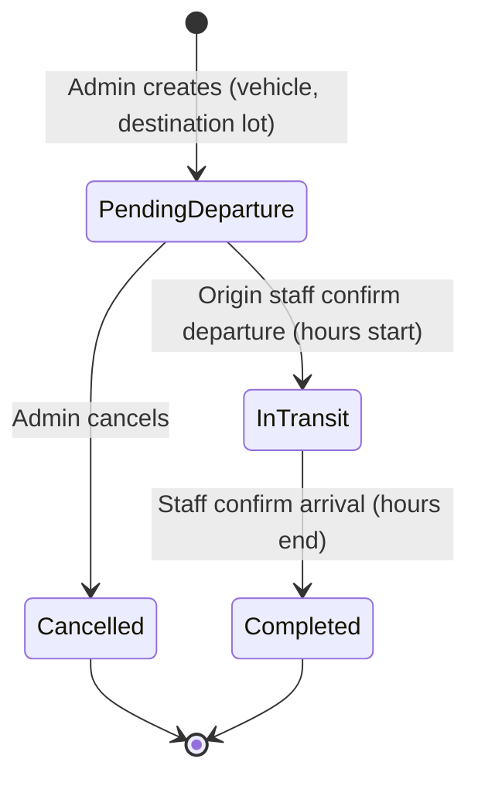

# Requirements — Vehicle & Parking Management System

**Version:** 1.1 · **Date:** 2026-11-23 · **Status:** v1.0 approved 2026-11-22 (D-013). The v1.1 changes were approved 2026-11-23 (D-020 to D-022; see §0, which overrides any older line below).
**Phase 1 deliverables in this file:** PRD/FRD (§1–§6), role matrix (§4), workflows (§7), non-functional requirements (§8), open items and proposals (§11).

**Sources, in priority order:**
1. `PROJECT_DECISIONS.md` (D-001 to D-012)
2. `docs/source/client-clarifications-2026-11-18.md`
3. `docs/source/requirements-v1-revised.pdf`
4. `docs/source/staff-ui-mockup.pdf` (workflow reference only)

**Tags:**
- `[D-0xx]` approved decision
- `[PDF]` original requirements PDF
- `[Client]` client clarifications
- `[P-nn]` a proposal from me, now approved (D-013, listed in §11)

---

## 0. Changes in v1.1 (2026-11-23)

| Change | Decision | Replaces |
|---|---|---|
| **The staff member is the driver.** There are no driver records, no driver picker and no Driver ID. The staff profile gains a driving licence number | D-020 | DRV-01–03; the driver parts of TRP-01, TRP-03 and TRF-01; P-01 (licence added) |
| **Start flow:** vehicle (scan or type) → destination → **staff signs** → review → start. *(The origin-lot step was removed by D-047: the origin is the lot the vehicle is parked at)* | D-020, D-047 | TRP-01 |
| **Swap:** change the vehicle, or **hand the trip over to another staff member**, who must have no active trip. Either way a new segment starts and a reason is required | D-020 | TRP-07 ("driver" swap) |
| **Hours:** staff hours and vehicle hours both come from segments. "Driver hours" in reports = staff hours | D-020 | BR-06, P-11 |
| **Transfers:** the admin chooses the vehicle and destination lot only. Any staff member confirms departure (D-047), and **that person drives it**. Any staff member confirms arrival | D-020, D-047 | TRF-01, TRF-02 |
| **Admins monitor only.** No ending, swapping or cancelling trips (TRP-11 and P-02 removed). They have a read-only trip detail, overdue alerts and the reminder log | D-021 | TRP-11, P-02, §4 rows |
| **Admins have no QR scanner** | D-021 | QR-05 (admin part) |
| **Navigation.** Staff tab bar: Home · Trips · Scan · Lots · Profile. Attendance is removed (D-023). Admin tab bar: Dashboard · Live · Manage · Reports | D-022 | UX-01, UX-12 |
| **Stuck trips (OI-10, closed).** A trip whose staff member can't act stays open, because nobody else can close it. Risk accepted (D-024) | D-021, D-024 | — |
| **Transfer driving counts as the active trip** (2026-11-26) | D-026 | BR-02 |
| **Staff have no assigned lots** (2026-11-27): any staff member starts from any active lot and confirms any transfer | D-047 | BR-03, STF-01, TRP-01, TRF-02, P-01, P-04 |
| **Backend rules** (2026-11-26): cookie sessions; one JSON error format; photos and signatures as files on the server; no auto-refresh; self-signed HTTPS; admin IDs `ADM`+YY+5 digits | D-031–D-037 | §8 Security, Real-time; AUTH-03; TRP-05 |
| **Attendance removed from the app.** No check in/out, breaks, photo + GPS, shift rules or attendance report. Location permission is no longer needed | D-023 | ATT-01–08; the shift settings in SET-01; the attendance report in RPT-02; the attendance navigation in D-022 |

---

## 1. Product summary

One mobile app (Android and iOS) with two roles, **Admin** and **Staff** `[D-007]`. It runs on one central API and one SQL Server database `[D-001]`.

It tracks municipal fleet vehicles (cars, garbage trucks, ambulances, and so on) as they leave and return to parking lots `[Client]`:
- who took each vehicle out (staff)
- who drove it (the staff member is the driver, D-020)
- where it went (destination)
- how long it was out
- how full each lot is.

~~It also records staff attendance~~ (removed in v1.1, D-023).

## 2. Scope

**In v1**
- Authentication and accounts
- Staff (who are also the drivers, D-020), vehicle catalogue, QR codes
- Parking lots with capacity and a map
- Destinations
- Trips: start, live timer, swap or hand-over, cancel, end (staff only; admins monitor, D-021)
- Transfers
- Reminders (push notifications)
- Admin dashboard and on-screen reports
- Settings, audit log

**Out of v1**
- Web portal `[D-001]`
- Billing and payments, maintenance management, fuel logs, live vehicle GPS `[D-009]`
- Report exports to PDF or Excel `[D-012]`
- Separate driver records, driver QR cards, driver app or driver login `[D-010, D-020]`
- More than one organisation `[D-009]`
- Offline mode `[D-009]`
- Arabic interface. Layouts are built ready for right-to-left so it can be added later `[D-012]`
- Vehicle-type restrictions on staff/drivers `[D-010]`
- Attendance `[D-023]`
- Admin trip actions (end, swap, cancel) and admin QR scanning `[D-021]`

## 3. Glossary

| Term | Meaning |
|---|---|
| Trip | One period a vehicle spends outside a lot, from Start to End (the client calls it a "vehicle session") |
| Segment | Part of a trip with one staff member (the driver) and one vehicle. Each swap closes the current segment and opens a new one `[D-012]` |
| Origin lot / return lot | The lot a trip starts from / the lot the vehicle comes back to (can be any lot) |
| Transfer | A move of a vehicle between lots, started by an admin |
| Destination | The Area → Location a vehicle is sent to |
| ~~Assigned lots~~ | Removed (D-047): staff aren't tied to lots |
| Operating hours | The total duration of segments (or trips, for staff hours); see BR-06 |
| "Not at a lot" | The vehicle's location is unknown or outside any lot (e.g. it broke down); an admin resolves it |

## 4. Roles and permissions

| Capability | Admin | Staff |
|---|:-:|:-:|
| Log in, log out, view own profile | ✓ | ✓ |
| Change own password `[P-14]` | ✓ | ✓ |
| Manage admin accounts `[D-009]` | ✓ | — |
| Manage staff: create, edit, deactivate, reset password | ✓ | — |
| ~~Manage drivers~~ (removed: the staff member is the driver, D-020) | — | — |
| Manage vehicle categories, types and vehicles; set Inactive or Under maintenance | ✓ | — |
| Download or print QR codes, single or bulk | ✓ | — |
| Scan a vehicle QR or type the registration number | — (D-021) | ✓ |
| Manage parking lots, capacity and baseline counts | ✓ | — |
| View lot details and availability for all lots | ✓ | ✓ |
| Map view of lots | ✓ | ✓ `[P-20]` |
| Manage destinations (areas, locations) | ✓ | — |
| Start a trip (from any active lot, D-047) | — `[P-22]` | ✓ |
| Swap (vehicle, or hand over to another staff member) or cancel an active trip | — (D-021) | Own trips |
| End a trip | — (D-021) | Own trips |
| View active trips | All, live | Own |
| View trip history | All | Own |
| Create a transfer | ✓ | — |
| Confirm transfer departure (the person who confirms drives it, D-020) | — | Any staff (D-047) |
| Confirm transfer arrival | — | Any staff `[P-04]` |
| ~~Record own attendance~~ (removed, D-023) | — | — |
| ~~View everyone's attendance~~ (removed, D-023) | — | — |
| Reminder and ID-prefix settings (shift settings removed, D-023) | ✓ | — |
| Dashboard and reports | ✓ | — |
| Receive trip reminders | All trips | Own trips |
| Audit log `[P-16]` | ✓ | — |
| Theme (System, Light, Dark) `[P-18]` | ✓ | ✓ |

The server enforces every permission. The app only hides what a role can't use `[D-007]`.

## 5. Functional requirements

### 5.1 Authentication and accounts (AUTH)

| ID | Requirement | Source |
|---|---|---|
| AUTH-01 | One login screen: ID + password. No role toggle; the role comes from the account | D-007 |
| AUTH-02 | "Remember me" keeps the session on the device | Mockup, P-19 |
| AUTH-03 | Staff IDs are generated as `{prefix}{YY}{NNNNN}` (e.g. `DM2600042`). The prefix is an admin setting (default `DM`, never `ADM`). Admin IDs are `ADM{YY}{NNNNN}` (e.g. `ADM2600001`), a separate sequence (D-037). Numbers are never reused. Login ignores letter case | D-011, D-037 |
| AUTH-04 | The admin creates staff accounts with an initial password. No forced change at first login | D-009 |
| AUTH-05 | Forgotten password: the admin resets staff passwords. Our team resets the first admin's. Admins can reset other admins' passwords | D-009, P-14 |
| AUTH-06 | Our team provisions the first admin account. Admins can add more admins, and every admin has full access | Client, D-009 |
| AUTH-07 | A deactivated account can't log in, and its open sessions end immediately | P-19 |
| AUTH-08 | The account locks for 15 minutes after 5 failed login attempts | P-15 |

### 5.2 Staff management (STF)

| ID | Requirement | Source |
|---|---|---|
| STF-01 | Create, edit, deactivate and reactivate staff. Fields: full name, photo, mobile, email (optional), Staff ID (generated), driving licence number (D-020), status. *(No assigned lots, D-047)* | P-01, D-020, D-047 |
| STF-02 | Reset a staff member's password | D-009 |
| STF-03 | View a staff member's trips and hours (attendance removed, D-023) | PDF |

### 5.3 Driver management (DRV): removed in v1.1 (D-020). Rows kept for history only.

| ID | Requirement | Source |
|---|---|---|
| DRV-01 | Create, edit, deactivate and reactivate drivers. Fields: photo, Driver ID (the existing employee number, unique), full name, mobile, licence number | D-010, D-012 |
| DRV-02 | Drivers don't log in and have no QR card. Staff pick them from a searchable list or type the Driver ID | D-010 |
| DRV-03 | Any driver can take any vehicle type | D-010 |

### 5.4 Vehicle catalogue (VEH)

| ID | Requirement | Source |
|---|---|---|
| VEH-01 | Manage categories and types. Each type belongs to one category | D-009 |
| VEH-02 | Manage vehicles. Fields: registration number (unique), category and type, brand, model, colour, photo | Client |
| VEH-03 | Statuses: **Available**, **Active** (set automatically by trips and transfers), **Inactive** and **Under maintenance** (set by the admin). A vehicle that is Inactive or Under maintenance can't be started or transferred | D-009 |
| VEH-04 | Current location: one lot, or "Not at a lot" | D-012 |
| VEH-05 | Vehicle history: trips, segments, transfers, status changes | PDF |

### 5.5 QR codes (QR)

| ID | Requirement | Source |
|---|---|---|
| QR-01 | Every vehicle gets a unique QR code when it's created. The code holds no readable data | PDF, D-009 |
| QR-02 | Download one QR as an image, or as a printable PDF label (QR + registration number + type) | D-009 |
| QR-03 | Bulk print: select vehicles → one PDF sheet of labels | D-009 |
| QR-04 | A damaged sticker is reprinted with the same code | D-009 |
| QR-05 | Scanning is for staff only; admins don't scan (D-021). If a scan fails, staff can type the registration number | D-009, D-021 |
| QR-06 | An unknown QR code, or one for a vehicle that can't be used, shows a clear error and the reason | P-19 |

### 5.6 Parking lots (LOT)

| ID | Requirement | Source |
|---|---|---|
| LOT-01 | Create, edit, activate and deactivate lots. Fields: name, code (unique), full address, Google Maps pin, contact person, contact number, opening and closing time, lot type (Open, Underground or Other), total capacity, capacity per vehicle type, status | Client |
| LOT-02 | The admin can set a baseline occupied count for spaces taken by vehicles outside the system, both per type and in total | D-009, P-09 |
| LOT-03 | Occupied and available spaces are calculated automatically, per type and in total (BR-05) | Client |
| LOT-04 | A full lot or vehicle type shows a warning but the action is still allowed. Over-capacity is flagged on the dashboard | D-009 |
| LOT-05 | Operating hours are shown for information only | D-009 |
| LOT-06 | A map view shows every lot with its availability | Client |
| LOT-07 | An inactive lot can't be used to start a trip, return a vehicle or receive a transfer | P-08 |

### 5.7 Destinations (DST)

| ID | Requirement | Source |
|---|---|---|
| DST-01 | The admin manages areas and locations. Each location belongs to one area | D-010 |
| DST-02 | A destination must be chosen when a trip starts | P-06 |

### 5.8 Trips (TRP)

| ID | Requirement | Source |
|---|---|---|
| TRP-01 | **Start** (staff), in order: ~~1. origin lot~~ (removed, D-047: the origin is the lot the vehicle is parked at) 2. vehicle (scan, or type the registration number) 3. destination (area → location) 4. **the staff member signs** on screen 5. confirm. The server records the start time. *(v1.1: no driver step; the staff member is the driver, D-020)* | Client, D-009, D-010, D-020 |
| TRP-02 | Start checks: the vehicle is Available and located at the origin lot `[P-07]`; the staff member has no other active trip (the staff member is the driver, D-020) | D-009, D-020 |
| TRP-03 | Recorded at start: staff name and ID (= driver, D-020), vehicle (registration, category, type, brand, model), origin lot, destination, signature, start date and time | Client |
| TRP-04 | A **live timer** shows in the Staff app's top bar from Start until End, on every screen | Client |
| TRP-05 | The admin sees every active trip with elapsed time (the timer ticks on the phone; the list updates when the admin refreshes, D-035) | Client, D-035 |
| TRP-06 | **Reminders:** after a duration the admin sets, the staff member gets a push notification, repeated every 30 minutes until the trip ends. The admin is alerted on the same schedule | D-009 |
| TRP-07 | **Swap (v1.1, D-020):** on an active trip, **change the vehicle**, or **hand the trip over to another staff member** (who must have no active trip; the trip and its live bar move to their phone). It stays the same trip; the current segment closes and a new one opens at the swap time. A reason is required `[P-03]`. The new vehicle must be Available and at a lot, and it leaves that lot. For the swapped-out vehicle, staff pick the lot where it is or mark "Not at a lot" | D-010, D-012, D-020 |
| TRP-08 | **Cancel:** reason category (driver, vehicle, technical or other issue) + note. The trip ends at the moment of cancelling and its hours count. Staff pick the lot where the vehicle is, or "Not at a lot". The vehicle's status doesn't change; the admin decides. *(D-043: the vehicle becomes Available there; admins are notified and set Inactive / Under maintenance if needed. Same for the old vehicle on a vehicle swap)* | D-010, D-012, D-043 |
| TRP-09 | **End** (staff, own trip): identify the vehicle (scan or type) → pick the return lot (any active lot) → confirm. The server records the end time | Client, D-010 |
| TRP-10 | **End summary:** vehicle details, category, origin and return lots, staff/driver(s) per segment, signature, destination, start, end, total duration, and segments if there were swaps | Client |
| TRP-11 | **Removed in v1.1 (D-021).** Old text: **Admin end:** the admin enters the actual end time (after the start, not in the future), a required reason, and the return lot or "Not at a lot". The action is audited | D-009 |
| TRP-12 | Trip history: staff see their own trips; admins see all trips, with filters | Client |

### 5.9 Transfers (TRF)

| ID | Requirement | Source |
|---|---|---|
| TRF-01 | The admin creates a transfer: vehicle (Available, at a lot), destination lot, optional note. **No driver is chosen** (D-020) | D-010, D-020 |
| TRF-02 | Any staff member confirms departure (D-047), and **that person drives** the vehicle. Hours start and the vehicle becomes Active | D-012, P-04, D-020, D-047 |
| TRF-03 | Until arrival is confirmed, the vehicle is counted at the origin lot | D-010 |
| TRF-04 | Any staff member confirms arrival at the destination. Hours end, and the vehicle becomes Available at the destination lot | D-010, P-04 |
| TRF-05 | Transfer hours count toward the hours of the staff member who confirmed departure (the driver) and the vehicle | D-010, D-020 |
| TRF-06 | The admin can cancel a transfer before departure | P-05 |
| TRF-07 | A transfer that is in transit gets the same reminder rule as trips | P-21 |

### 5.10 Attendance (ATT): removed in v1.1 (D-023). Rows kept for history only.

| ID | Requirement | Source |
|---|---|---|
| ATT-01 | Staff record their own attendance on their own phone: check in, lunch start and end, tea start and end, check out | D-010, D-012 |
| ATT-02 | Every entry needs a live camera photo and a GPS location. The time comes from the server. There is no geofence | D-010 |
| ATT-03 | The admin sets the shift start time, working days and grace period. One shift applies to all staff | D-012, P-10 |
| ATT-04 | **Late** = check-in after shift start plus grace. **Absent** = no check-in on a working day | D-012 |
| ATT-05 | Staff see their day's timeline and their monthly Present, Absent and Late counts | Mockup |
| ATT-06 | The admin sees everyone's attendance, including photo and location, with filters | Derived |
| ATT-07 | Order rules: one check-in per day; check-out only after check-in; a break end needs a matching break start | P-11b |
| ATT-08 | If camera or location permission is denied, the entry is blocked and the app explains how to allow it | P-11b |

### 5.11 Notifications (NTF)

| ID | Requirement | Source |
|---|---|---|
| NTF-01 | Push notifications for trip and transfer reminders (TRP-06, TRF-07). *Until a Firebase project exists, reminders go to the in-app list only (D-039)* | D-009, D-039 |
| NTF-02 | Push notifications to the relevant staff when a transfer is waiting for departure or arrival. *(Relevant staff = all active staff, since staff have no lots, D-047, D-048)* | P-17, D-048 |
| NTF-03 | An in-app list of notifications | P-17 |

### 5.12 Dashboard and reports (RPT)

| ID | Requirement | Source |
|---|---|---|
| RPT-01 | Admin dashboard: vehicles by status, trips active now, completed trips in the chosen period, staff totals, free spaces, lot utilization (occupied and available per lot and per type), over-capacity flags, trips over the reminder threshold | PDF, Client |
| RPT-02 | Reports on screen with filters (date range, lot, category or type, vehicle, staff): vehicle running hours · staff hours and activity (= driver hours, D-020) · lot utilization · trip log (including cancelled, swapped and handed-over trips) · transfer history. *(v1.1: attendance report removed, D-023; no admin-ended trips, D-021)* | PDF, D-009, D-012, D-020 |
| RPT-03 | No exports in v1 | D-012 |
| RPT-04 | Hours that cross midnight are split by calendar day in date-filtered reports | P-12 |

### 5.13 Settings and audit (SET, AUD)

| ID | Requirement | Source |
|---|---|---|
| SET-01 | Admin settings: Staff ID prefix, reminder delay *(shift settings removed, D-023)* | D-011, D-009, D-023 |
| SET-02 | Settings for every user: theme (System, Light, Dark), profile, change password, logout | P-18, P-14 |
| AUD-01 | Every admin create, edit or deactivate action is logged with who, when and the before/after values. So are password resets, transfers and status changes *(no manual trip ends in v1.1, D-021)* | P-16, D-021 |
| AUD-02 | Admins can view the audit log, with filters | P-16 |

## 6. Business rules

| ID | Rule | Source |
|---|---|---|
| BR-01 | Every timestamp comes from the server clock. Times are stored in UTC and shown in Gulf Standard Time (UTC+4) | P-13 |
| BR-02 | One active trip per staff member (staff are the drivers). Driving an in-transit transfer counts as that active trip (D-026). One active trip or in-transit transfer per vehicle | D-009, D-020, D-026 |
| BR-03 | Staff start trips from any active lot (the lot the vehicle is parked at) and can return vehicles to any active lot. *(Was: assigned lots only; changed by D-047)* | D-009, D-010, D-047 |
| BR-04 | Only a vehicle that is Available and located at the origin lot can be started or transferred | P-07 |
| BR-05 | A lot's occupied spaces (per type and in total) = the baseline count + vehicles located there and not on a trip + vehicles in a transfer that hasn't arrived yet. Available spaces = capacity − occupied | Client, D-009, D-010 |
| BR-06 | Staff hours (staff are the drivers) and vehicle hours = the total of their segment durations. A hand-over or vehicle swap splits the hours at the swap time | D-012, D-020 (replaces P-11) |
| BR-07 | Hours count for cancelled trips. *(No admin-ended trips in v1.1, D-021)* | D-010, D-021 |
| BR-08 | Records are deactivated, never deleted. Deactivated records stay in history and reports | D-009 |
| BR-09 | Capacity warnings never block an action | D-009 |
| BR-10 | Trip states: Active → Ended, or Cancelled (no "Ended by admin", D-021; a trip whose staff member can't act stays Active, D-024). Transfer states: Pending departure → In transit → Completed, or Pending departure → Cancelled | D-009, D-010, D-012 |

## 7. Workflows

### 7.1 Trip lifecycle

```mermaid
stateDiagram-v2
    [*] --> Active: Staff starts (vehicle, destination, staff signature)
    Active --> Active: Swap vehicle or hand over to another staff (new segment)
    Active --> Ended: Staff ends (return lot)
    Active --> Cancelled: Staff cancels (reason; hours count)
    Ended --> [*]
    Cancelled --> [*]
```

Reminders run while a trip is Active: the first after the admin-set delay, then every 30 minutes, to the staff member and the admin.

### 7.2 Transfer lifecycle

The vehicle stays counted at the origin lot until the transfer is Completed.

### 7.3 Key journeys

1. **Admin setup:** categories and types → lots (capacity, baseline count) → destinations → vehicles (QR generated) → print labels → staff (licence).
2. **Staff start:** home → Scan → vehicle → destination → staff signs → review → start → live bar runs.
3. **Staff end:** timer bar or Active trip → End → scan vehicle → return lot → confirm → summary.
4. **Swap:** active trip → Swap → **change vehicle** (scan new, reason, place the old one: lot or "Not at a lot") **or hand over** (pick staff with no active trip, reason) → confirm.
5. **Cancel:** active trip → Cancel → reason + note → place the vehicle → confirm.
6. **Forgotten trip:** reminders to the staff member and the admin → only the staff member can end it; the admin monitors (D-021). See OI-10.
7. **Transfer:** admin creates → origin staff are notified and confirm departure → destination staff confirm arrival.
8. ~~**Attendance**~~: removed (D-023).
9. **Monitoring:** dashboard → live active trips → reports with filters.

## 8. Non-functional requirements

All targets here are `[P-19]` unless tagged otherwise.

| Area | Requirement |
|---|---|
| Platforms | Android 8.0+ (API 26) and iOS 15+, phone, portrait. Tablets work but aren't specially optimised |
| Connectivity | Online only `[D-009]`. The app shows a clear offline state and lets the user retry; it never loses an action without telling the user |
| Performance | API p95 < 500 ms for standard requests. Scan to vehicle details < 2 s. App cold start < 3 s on a mid-range phone |
| Real-time | ~~The admin's active-trip list and dashboard update within 5 s of a change~~ Superseded by D-035: no auto-updates; data loads on screen open and manual pull to refresh. Trip timers tick on the phone |
| Availability | 99.5% monthly uptime for the API |
| Security | HTTPS (TLS 1.2+) with a self-signed certificate that the app accepts without verification (D-036, risk accepted). ~~Passwords stored with a modern adaptive hash.~~ Passwords stored as plain text, by owner decision (D-051, risk accepted). **Cookie-based sessions** (HttpOnly, Secure, encrypted; ended immediately on deactivation or password reset) *(replaces "short-lived access tokens with refresh tokens", D-031)*. Permissions checked on the server for every request. Login lockout (AUTH-08). The session cookie is kept in the platform's secure storage. Audit log (AUD-01). Follows the OWASP mobile security standard (MASVS) |
| Privacy | Staff and vehicle photos, signatures, phone numbers and licence numbers are personal data (attendance photos and GPS removed, D-023). Only admins see other people's data. Privacy policy text and retention periods come from the client (OI-02) |
| Accessibility | WCAG 2.2 AA contrast. Supports the system text size. Touch targets ≥ 48 dp. Screen-reader labels |
| Localization | English. Every string is kept outside the code. Right-to-left-ready layouts (direction-aware spacing, mirrored directional icons) `[D-012]` |
| Theming | Light and dark designed as complete systems `[D-004]` |
| Observability | Crash reporting in the app. Every API error logged with a trace ID (database, file fallback) and returned in one JSON format, never HTML (D-032). Health checks |
| Data protection | Daily database backups and a tested restore procedure. Details in Phase 10 |

## 9. Information stored (high level; detailed in Phase 6)

- Users (admins, staff) and their roles
- ~~Staff lot assignments~~ (removed, D-047)
- ~~Drivers~~ (staff are the drivers, D-020)
- Vehicle categories and types; vehicles and their QR codes
- Parking lots, with capacity per type and baseline counts
- Areas and locations
- Trips, trip segments and signatures
- Transfers
- ~~Attendance entries~~ (removed, D-023)
- Shift and app settings
- Notifications
- Audit log

## 10. Integrations

| Integration | Used for | Note |
|---|---|---|
| Google Maps | Lot pin picking and the map view | Needs a Google Cloud API key and billing account (OI-03) |
| FCM (Android) / APNs (iOS) | Push reminders and transfer alerts | Needs Firebase and Apple developer accounts |
| Device camera | QR scanning (staff only) | Requires runtime permission |
| ~~Device location~~ | ~~GPS on attendance entries~~: not needed after D-023 | — |
| PDF generation | QR labels, single and bulk | Generated in the Flutter app; the API returns label data (D-040) |
| System share sheet | Sharing QR images and labels | — |

## 11. Proposals and open items

### 11.1 Proposals (all approved 2026-11-22, D-013)

| ID | Proposal |
|---|---|
| P-01 | Staff profile fields: full name, photo, mobile, optional email, ~~assigned lots~~ (removed, D-047) |
| P-02 | Admins can swap or cancel any active trip, as well as end it |
| P-03 | A reason is required when swapping the driver or vehicle |
| P-04 | Transfer departure is confirmed by ~~staff of the origin lot~~ any staff member (D-047); arrival by any staff member |
| P-05 | Admins can cancel a transfer before departure |
| P-06 | A destination is required at Start |
| P-07 | The vehicle must be located at the origin lot to start; otherwise Start is blocked with a message |
| P-08 | Inactive lots can't be used for Start, return or transfers |
| P-09 | Baseline occupied counts are kept per type and in total |
| P-10 | One shift setting for all staff (no per-person shifts in v1) |
| P-11 | **Superseded by D-020 (hours by segment per staff member).** Old: Staff hours = the full duration of the trips they started (swaps don't move staff hours). P-11b: attendance order rules and blocking on denied permissions (ATT-07, ATT-08) |
| P-12 | Hours that cross midnight are split by calendar day in reports |
| P-13 | All times come from the server, are stored in UTC and shown in GST |
| P-14 | Users can change their own password; admins can reset other admins' passwords |
| P-15 | Lockout: 5 failed attempts → 15 minutes |
| P-16 | An audit log of admin actions that admins can view |
| P-17 | Push notifications for transfers, plus an in-app notification list |
| P-18 | Theme choice: System, Light or Dark |
| P-19 | The targets in §8, session behaviour (AUTH-02, AUTH-07) and error handling (QR-06) |
| P-20 | Staff can see the map view too |
| P-21 | Transfers in transit use the same reminder rule as trips |
| P-22 | Only staff start trips (admins monitor, end, swap and cancel) |

### 11.2 Open items (information needed, not blocking UX)

| ID | Item | Needed by |
|---|---|---|
| OI-01 | Scale: vehicles, lots, staff, trips per day (A3) | Phase 5 |
| OI-02 | Privacy policy text, data retention periods, and which data-protection rules apply | Phase 7 |
| OI-03 | Who owns the Google Maps API key and billing account | Phase 7 |
| OI-04 | App name, icon and logo (placeholder: "DM") | Phase 4 |
| OI-05 | App store accounts and distribution: public, unlisted or private | Phase 10 |
| OI-06 | Hosting: the existing Sufizz Bikes backend server (D-028). SQL Server 2019 Express RTM | Phase 5 |
| OI-07 | Development machine: Windows 11 (D-025). Install Flutter, Docker or SQL Server tooling when their phases start | Phase 7 |
| OI-08 | Tell the client: one app with roles replaces the two apps in the PDF (D-007); admin views refresh manually instead of "real time" (D-035) | Before Phase 4 sign-off |
| OI-09 | .NET 8 is past end of support; revisit D-008 | Before Phase 7 |
| OI-10 | ~~How does a trip close if its staff member can't act?~~ Closed by D-024: it stays open; risk accepted | — |
| OI-11 | iOS builds and signing: a Mac or a cloud macOS build service (development is on Windows, D-025) | Phase 8 |
| OI-12 | **Resolved 2026-11-27 (D-052):** new database `VehicleManagementDM` (D-029), connected with the `sa` login by owner choice (risk accepted) | Phase 7 |
| OI-14 | ~~HTTPS with a domain name and a real certificate~~ Closed by D-036: self-signed certificate, accepted by the app (risk accepted) | — |
| OI-13 | ~~Server's exact ASP.NET Core 8 runtime patch and hosting model~~ **Resolved 2026-11-27 (D-050):** IIS, ASP.NET Core 8.0.18, port 8445 | Before first deploy |
