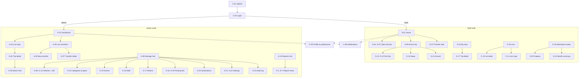

# UX Architecture — Phase 2

**Version:** 0.1 draft · **Date:** 2026-11-22 · **Status:** Proposed. Needs owner approval (§10, D-014)
**Based on:** `REQUIREMENTS.md` v1.0 (D-013). Wireframes: `docs/ux/wireframes.html`.
**Scope:** structure and behaviour only. Colour, type and visual style come in Phase 3. The wireframes are deliberately greyscale.

---

## 1. UX principles for this product

1. **Field-first for staff.** Staff use their own phones outdoors, often one-handed, at a lot, with a driver waiting. The core tasks (start, end, check in) must be fast and hard to get wrong. Targets: start a trip in ≤ 6 taps after scanning; end one in ≤ 4.
2. **One obvious next action.** Every staff screen has one primary button. The home screen changes with the current state: no trip → **Start trip**; trip active → **End trip**.
3. **The timer is always visible.** While a trip is active, a bar pinned to the top of every staff screen shows the elapsed time. This is a client requirement (TRP-04).
4. **Scan first, type as fallback.** Every vehicle lookup opens the camera, and a "Type registration number" option is always one tap away (QR-05).
5. **Make it hard to get wrong.** Start ends on a review screen. Every irreversible action (end, cancel, admin end) has a confirmation sheet that restates what will happen. Problems are explained (BR-04) before the user commits.
6. **Admins manage by exception.** The dashboard leads with what needs attention: overdue trips, vehicles "Not at a lot", over-capacity lots, pending transfers. Totals come second.
7. **Calm, enterprise UI.** No decorative KPI tiles and no rainbow status colours. Status colour is used only where it carries meaning, and never on its own (always with text or an icon).
8. **Built for right-to-left.** Layouts use start/end, not left/right. Directional icons mirror. Times and numbers stay in a stable order.
9. **Online-only, honest about it.** When the connection is lost, a banner says so and actions that need the server are disabled with an explanation. No action is ever lost silently.

## 2. Users (proto-personas, assumptions to validate)

| | Staff (lot operator) | Admin (fleet supervisor) |
|---|---|---|
| Device | Personal phone, outdoors, varied phone quality | Phone; may also be at a desk |
| Context | At a lot, a driver waiting, glare, gloves possible | Office or on the move; monitoring many lots |
| Frequency | Many starts and ends per shift | Monitors all day; master data occasionally |
| Main jobs | Start, end, fix a trip (swap or cancel); attendance; check lot space; confirm transfers | Watch live activity; respond to reminders and overdue trips; set up master data; run reports |
| Main risks | Wrong vehicle or driver; forgetting to end; poor signal | Missing an overdue vehicle; inaccurate hours; data-entry errors |

These are derived from the requirements, not from research. They should be validated with 2–3 real staff and 1 admin before Phase 4 sign-off.

## 3. Navigation model (proposed, UX-01)

> **Updated 2026-11-23 (D-022, D-020, D-021).** These override the tables below:
> - **Staff tabs:** Home · Trips · **Scan** (raised centre) · Lots · **Profile**. Attendance is no longer a tab; it opens from the Home attendance card and from Profile.
> - **Admin tabs:** Dashboard · Live · Manage · Reports. Admins have no Scan button and no scanner.
> - **Start trip:** has no driver step. Flow: Lot? → Vehicle → Destination → Signature (staff) → Review.
> - **Swap (S-14):** change the vehicle, or hand the trip over to another staff member.
> - **Admins:** A-05 (admin end) is removed. A-04 is a read-only trip detail with the reminder log.
> - **New screen S-24 Profile:** details, licence, assigned lots, my trips this month, theme, password, log out.
> - **Attendance removed from the app (D-023):** screens S-19–S-21, J7 and the attendance states no longer apply.

One app. After login, the account's role decides which shell loads (D-007).

**Staff shell: bottom navigation with 4 tabs**

| Tab | Purpose | Main content |
|---|---|---|
| Home | Today's work | Active trip card or a Start trip button · attendance status · transfer tasks · my lot's availability |
| Trips | Vehicles I started (Client §1) | Active trip + history; filter by date |
| Lots | Space across all lots (Client §1) | List with availability per type; map toggle |
| Attendance | My attendance | Today's timeline + next action; monthly summary |

**Admin shell: bottom navigation with 4 tabs**

| Tab | Purpose | Main content |
|---|---|---|
| Dashboard | What needs attention + totals | Alerts first, then fleet status, lot use, today's activity |
| Live | Everything moving right now | Two views: **Trips** (active, overdue first) and **Transfers** (pending departure, in transit) |
| Manage | Master data and system settings | Grouped hub: Fleet · People · Places · System |
| Reports | On-screen reports | 7 reports with a shared filter sheet |

**Top bar, both roles:** screen title · notifications bell (with a badge) · avatar (opens Profile and preferences). Admins also get a **scan** icon, which opens a vehicle by its QR (QR-05).

**Staff active-trip bar (UX-02):** pinned under the status bar on every staff screen while a trip is active. It shows the vehicle registration and a live elapsed time (hh:mm:ss). Tapping it opens Active trip. An overdue trip gets a stronger, non-colour-only style (an icon plus "Overdue").

### 3.1 Sitemap

## 4. Screen inventory

C = common · S = staff · A = admin · R = report. "Req" points to `REQUIREMENTS.md`.

### 4.1 Common

| ID | Screen | Req | Notes |
|---|---|---|---|
| C-01 | Splash | — | Checks the session, then routes by role |
| C-02 | Login | AUTH-01..08 | ID + password, show/hide, Remember me, Forgot password |
| C-03 | Forgot password (sheet) | AUTH-05 | Explains that the admin (or support) resets passwords; no self-service |
| C-04 | Permission primer (sheet) | ATT-08, NTF | Shown just before camera, location or notifications are first needed |
| C-05 | Profile & preferences | SET-02 | Profile details · theme (System, Light, Dark) · change password · logout |
| C-06 | Change password | P-14 | Current, new, confirm |
| C-07 | Account notice | AUTH-07 | Shown on session expiry or deactivation; leads to Login |
| C-08 | Notifications | NTF-03 | Grouped by day; tapping one opens its target |
| C-09 | Vehicle scanner | QR-05, QR-06 | Camera viewfinder · torch · "Type registration number" · result card or a blocking reason |
| C-10 | Lot detail | LOT-01, LOT-07 | Availability per type, address, contact, hours; Edit for admins |
| C-11 | Lots map | LOT-06 | Pins showing availability; tapping a pin opens a summary card that leads to C-10 |

### 4.2 Staff

| ID | Screen | Req | Notes |
|---|---|---|---|
| S-01 | Home | TRP-04, ATT, TRF | Changes with state: no trip, active trip, overdue; not checked in, on break, checked out; transfer tasks |
| S-02 | Start · Lot | TRP-01 | Skipped when the staff member has only one assigned lot |
| S-03 | Start · Vehicle | TRP-01, TRP-02 | C-09, then a vehicle confirm card; blocks with the reason if the vehicle isn't eligible |
| S-04 | Start · Driver | DRV-02, BR-02 | Search by name or ID · recent drivers first · a busy driver is shown but can't be picked |
| S-05 | Start · Destination | DST-02 | Pick an area, then a location (two levels in one screen) |
| S-06 | Start · Signature | TRP-01 | Full-width pad · Clear · signed by (driver name) |
| S-07 | Start · Review | TRP-03 | Summary of everything + **Start trip**; edit links go back to each step |
| S-08 | Trip started | — | Short success message, then Home with the timer bar |
| S-09 | Active trip | TRP-04..08 | Large timer · vehicle, driver, origin, destination · segments · **End trip** · Swap · Cancel |
| S-10 | End · Verify vehicle | TRP-09 | Scan or type; must match the trip's current vehicle |
| S-11 | End · Return lot | TRP-09, LOT-04 | Origin lot pre-selected; any active lot allowed; capacity warning inline |
| S-12 | End · Confirm (sheet) | TRP-09 | Restates the vehicle, return lot and duration |
| S-13 | Trip summary | TRP-10 | Everything the client listed + segments; Done → Home |
| S-14 | Swap | TRP-07 | Choose driver / vehicle / both → pick → reason → place the old vehicle (lot or Not at a lot) → confirm |
| S-15 | Cancel trip | TRP-08 | Reason category + note → place the vehicle → confirm (hours count, and the screen says so) |
| S-16 | My trips | TRP-12 | Active card pinned at the top; history grouped by day; date filter |
| S-17 | Trip detail | TRP-10 | Read-only; segment timeline |
| S-18 | Lots | LOT-07 | Search; availability per lot (total + per type); list/map toggle (C-11) |
| S-19 | Attendance · Today | ATT-01..05 | Timeline of today's events + one next-action button |
| S-20 | Attendance · Capture | ATT-02, ATT-08 | Front camera, location status, server time shown after submit; Retake / Submit |
| S-21 | Attendance · Month | ATT-05 | Present, Absent and Late counts + a calendar with per-day status |
| S-22 | Transfer task | TRF-02, TRF-04 | Shows the transfer; **Confirm departure** (origin staff) or **Confirm arrival** (any staff) |

### 4.3 Admin

| ID | Screen | Req | Notes |
|---|---|---|---|
| A-01 | Dashboard | RPT-01 | Needs attention (overdue, Not at a lot, over capacity, pending transfers) → fleet status → lot use → today |
| A-02 | Live · Trips | TRP-05 | Updates live · overdue first · elapsed time ticking · filter by lot or type |
| A-03 | Live · Transfers | TRF | Pending departure / in transit · **New transfer** |
| A-04 | Trip detail (admin) | TRP-07, 08, 11 | Same as S-09, plus who started it · **End trip** · Swap · Cancel |
| A-05 | Admin end | TRP-11 | Actual end time (date-time picker, limited to start…now) · reason (required) · return lot or Not at a lot |
| A-06 | New transfer | TRF-01 | Vehicle (scan or search) · destination lot · driver → create |
| A-07 | Transfer detail | TRF-01..06 | Status timeline · Cancel (only before departure) |
| A-08 | Manage hub | — | Fleet: Vehicles, Categories & types, QR labels · People: Staff, Drivers, Admins · Places: Parking lots, Destinations · System: App settings, Attendance rules, Audit log |
| A-09 | Vehicles | VEH | Search · filter by status, type or lot · "Not at a lot" filter |
| A-10 | Vehicle detail | VEH-03..05, QR | Info · status (change to Inactive or Under maintenance) · location (set when Not at a lot) · QR · history |
| A-11 | Vehicle form | VEH-02 | Registration, category → type, brand, model, colour, photo |
| A-12 | QR label | QR-02, QR-04 | Preview · download image / PDF · share |
| A-13 | Bulk QR print | QR-03 | Select vehicles (filters, select all) → generate PDF → share or print |
| A-14 | Categories & types | VEH-01 | Category list with expandable types; add or edit inline |
| A-15 | Drivers · list / detail / form | DRV-01 | Detail shows recent trips and hours |
| A-16 | Staff · list / detail / form | STF-01..03 | Generated ID shown after creation · assigned lots · reset password · trips · attendance |
| A-17 | Admins · list / form | AUTH-05, 06 | Add an admin · reset password · deactivate (can't deactivate yourself) |
| A-18 | Parking lots · list / detail / form | LOT-01, 02 | Form sections: basics · location (A-19) · contact and hours · capacity per type · baseline counts |
| A-19 | Map pin picker | LOT-01 | Search an address or drag the pin |
| A-20 | Destinations | DST-01 | Areas → locations; add or edit inline |
| A-21 | App settings | SET-01 | Staff ID prefix (with a live example) · reminder delay |
| A-22 | Attendance rules | ATT-03 | Shift start · working days · grace period |
| A-23 | Audit log | AUD-01, 02 | Filter by user, entity or date → entry detail (before/after) |
| A-24 | Reports hub | RPT-02 | The 7 reports, each with a one-line description |
| R-1..R-7 | Report views | RPT-02, 04 | Filter chips + summary row + table/list + drill-down. R-1 Vehicle hours · R-2 Staff activity · R-3 Driver hours · R-4 Lot utilization · R-5 Trip log · R-6 Transfers · R-7 Attendance |

## 5. Key journeys

### J1 · Staff starts a trip (target ≤ 6 taps after the scan)

| # | Screen | User | System | Edge cases |
|---|---|---|---|---|
| 1 | S-01 | Taps **Start trip** | Opens the flow; lot step skipped if only one lot | Already on an active trip → Start is hidden (BR-02) |
| 2 | S-03 / C-09 | Scans the vehicle QR | Shows the vehicle card (photo, registration, type, current lot) | Unknown QR · vehicle at another lot · Inactive or Under maintenance · already on a trip → a blocking card explains why and how to fix it |
| 3 | S-04 | Picks the driver (recent first) or types the ID | Validates | Driver busy on another trip → greyed out with "On trip since 09:12" |
| 4 | S-05 | Picks area → location | — | — |
| 5 | S-06 | Hands the phone to the driver, who signs | — | Empty signature → Next disabled, with a hint |
| 6 | S-07 | Reviews and taps **Start trip** | Server records the time; the timer bar appears | Network error → inputs kept, **Retry**. Vehicle taken in the meantime → a conflict message and back to step 2 |

### J2 · Staff ends a trip (target ≤ 4 taps)

Timer bar or **End trip** on Home → scan or type the vehicle (must match) → return lot (origin pre-selected; a full lot shows a warning but is allowed) → confirm sheet → **S-13 summary**.

### J3 · Swap mid-trip

S-09 → **Swap** → choose Driver / Vehicle / Both → pick the new one(s) (same rules as Start) → reason → for a vehicle swap, place the old vehicle (pick a lot or **Not at a lot**) → confirm. The trip continues, and a new segment shows in the timeline.

### J4 · Cancel a trip

S-09 → **Cancel trip** → reason (driver, vehicle, technical or other issue) + note → place the vehicle → the confirm sheet states "Trip ends now. Hours count." The vehicle's status doesn't change; the admin is notified.

### J5 · Forgotten trip (reminders)

Reminder push → tapping it opens S-09 → staff end the trip. In parallel the admin gets an alert → A-02 (the trip shows as overdue) → A-04 → **End trip** → A-05 actual time + reason → audited. The staff member's timer bar disappears, with the notification "Trip ended by admin".

### J6 · Transfer

Admin: A-03 → **New transfer** → vehicle, destination, driver → staff of the origin lot get a push → S-22 **Confirm departure** (hours start) → on arrival, any staff member opens the task (from a push or by scanning) → **Confirm arrival**.

### J7 · Attendance day

S-19 shows one next action: **Check in** → S-20 (photo + location + submit) → later **Start lunch** / **End lunch**, **Start tea** / **End tea** → **Check out**. Late is flagged on the timeline after check-in when it applies. Permission denied → C-04 explains and links to system settings.

### J8 · Admin setup (first run)

Manage → Categories & types → Parking lots (capacity per type, baseline) → Destinations → Vehicles (QR generated) → Bulk QR print → Drivers → Staff (assign lots; share the ID and password). The empty state of each list says what to create first.

### J9 · Admin monitoring

Dashboard "Needs attention" → tap an item to go to its list → act. Live updates within 5 s. Reports → pick a report → filter → drill down to a trip.

## 6. States (every data screen)

| State | Pattern |
|---|---|
| Loading | Skeleton in the content's shape; no blocking spinners on a full screen |
| Empty | Short headline + one line saying why + a primary action if the user can do something ("No vehicles yet" → **Add vehicle**) |
| Error | What happened + **Retry**; inline next to the field for form errors |
| Offline | A banner under the top bar ("You're offline. Actions are paused."). Buttons that need the server are disabled, with the reason shown on tap. Data already loaded stays visible, marked "Last updated hh:mm" |
| Success | A short message for small actions; a full summary screen for trip end and trip start |
| Conflict | "This vehicle was just started by Ahmed" + refresh and return to the right step |
| Permission | A primer sheet before the system prompt; if denied, an explanation + **Open settings** |
| Session | Expired or deactivated → C-07 → Login |
| Capacity warning | Inline warning on the lot choice; never blocks (BR-09) |
| Overdue | Timer bar + list rows show an icon + "Overdue" text; elapsed time keeps counting |

## 7. Interaction patterns

| Pattern | Rule |
|---|---|
| Stepped flow (Start, Swap, Cancel) | A step indicator (e.g. "Step 2 of 5"), Back keeps what was entered, and a Close asks before throwing it away |
| Confirm sheet | Used for End, Cancel and Admin end: restates who, what and when; one primary + one secondary action |
| Pickers | Lists over 7 items get search; recent items first; disabled items show the reason |
| Forms | One page, grouped into sections, Save pinned at the bottom; validate on blur and on submit; errors under the field |
| Lists | Pull to refresh; load more as you scroll; filter chips under the search |
| Live data | The admin's Live tab and Dashboard update automatically; elapsed times tick on the device; "Live" indicator |
| Destructive actions | Deactivate needs a confirmation that explains the effect ("Can't log in. History is kept.") |
| Time display | 24-hour `HH:mm`, durations `hh:mm:ss` or "2 h 15 min"; GST |
| Touch | Targets ≥ 48 dp, ≥ 8 dp apart; primary actions in the bottom thumb zone |

## 8. Accessibility and right-to-left

- Text contrast ≥ 4.5:1 and UI parts ≥ 3:1. Canary yellow is never used for text on light surfaces (D-004).
- Supports the system font size up to 200% with no clipped text. The timer bar wraps instead of truncating.
- Every icon-only button has a screen-reader label. The timer announces the elapsed time at most once a minute.
- Status always shows as icon + text, never colour alone.
- Right-to-left: layouts use start/end, directional icons (back, chevrons) mirror, the timeline flips, and numbers and times stay left-to-right inside right-to-left text.

## 9. Microcopy rules

Sentence case. Buttons are verbs ("Start trip", "Confirm arrival"). Errors say what happened and what to do next. Trip vocabulary is fixed: **Start trip / End trip / Swap / Cancel trip**. "Session" isn't used in the interface.

## 10. UX decisions to approve (D-014)

| ID | Decision |
|---|---|
| UX-01 | Bottom navigation by role. Staff: Home · Trips · Lots · Attendance. Admin: Dashboard · Live · Manage · Reports. Profile under the avatar; notifications under the bell |
| UX-02 | The active-trip bar is pinned on every staff screen; it opens Active trip |
| UX-03 | Start trip as a stepped flow: Lot (only if needed) → Vehicle → Driver → Destination → Signature → Review |
| UX-04 | End trip checks the vehicle by scan or typing; the return lot defaults to the origin lot |
| UX-05 | Confirm sheets for End, Cancel and Admin end; a review screen for Start |
| UX-06 | The admin's Live tab combines active trips (overdue first) and transfers |
| UX-07 | The Manage hub is grouped Fleet · People · Places · System |
| UX-08 | Recent drivers appear first in the driver picker |
| UX-09 | Attendance shows one next-action button plus a timeline |
| UX-10 | The dashboard leads with "Needs attention"; no decorative KPI tiles |
| UX-11 | Permission primers appear just in time, not at first launch |
| UX-12 | A raised centre **Scan** button in the **staff** tab bar only (Home · Trips · Scan · Lots · Profile). Admins have none. Updated 2026-11-23 (D-022, superseding D-019); see `docs/design/mockups/UI_Mockups_v1.pdf` |
