# UX Architecture — Phase 2

**Version:** 0.2 · **Date:** 2026-11-26 · **Status:** Proposed. Needs owner approval (§10, D-014)
**Based on:** `REQUIREMENTS.md` v1.1, including D-020 (staff = driver), D-021 (admins monitor only), D-022 (tab bars) and D-023 (no attendance).
**Visual design:** `docs/design/DESIGN_SYSTEM.md` and `docs/design/mockups/UI_Mockups_v1.pdf`. Greyscale structure wireframes from v0.1 are in `docs/ux/wireframes.html` (history: they still show the driver step, admin end and attendance).
**Change history:**
- v0.1 (2026-11-22): first structure.
- v0.2 (2026-11-26): driver step, admin end, admin scanner and attendance removed; Profile tab, hand-over swap and read-only admin trip detail added.

---

## 1. UX principles for this product

1. **Field-first for staff.** Staff are the drivers. They use their own phones outdoors, often one-handed, at a lot. The core tasks (start and end a trip) must be fast and hard to get wrong. Targets: start a trip in ≤ 5 taps after scanning; end one in ≤ 4.
2. **One obvious next action.** Every staff screen has one primary button. The home screen changes with the current state: no trip → **Scan to start trip**; trip active → **End trip**.
3. **The timer is always visible.** While a trip is active, an amber bar pinned to the top of every staff screen shows the plate and the elapsed time. It turns red when overdue. This is a client requirement (TRP-04).
4. **Scan first, type as fallback.** Every vehicle lookup opens the camera, and a "Type registration number" option is always one tap away. Only staff scan.
5. **Make it hard to get wrong.** Start ends on a review screen. End and Cancel have a confirmation that restates what will happen. Problems are explained (BR-04) before the user commits.
6. **Admins monitor by exception.** The dashboard leads with what needs attention: overdue trips, vehicles "Not at a lot", over-capacity lots, waiting transfers. Admins never act on trips (D-021).
7. **Clear status.** Status colour is used only where it carries meaning, and always with an icon and a word.
8. **Built for right-to-left.** Layouts use start/end, not left/right. Directional icons mirror. Times and numbers stay in a stable order.
9. **Online-only, honest about it.** When the connection is lost, a banner says so and actions that need the server are disabled with an explanation. No action is ever lost silently.

## 2. Users (proto-personas, assumptions to validate)

| | Staff (driver) | Admin (fleet supervisor) |
|---|---|---|
| Device | Personal phone, outdoors, varied phone quality | Phone; may also be at a desk |
| Context | At a lot or on the road, glare, gloves possible | Office or on the move; monitoring many lots |
| Frequency | Many starts and ends per shift | Monitors all day; master data occasionally |
| Main jobs | Start, end, fix a trip (swap vehicle, hand over, cancel); check lot space; confirm transfers | Watch live activity; follow up on overdue trips; set up master data; create transfers; run reports |
| Main risks | Wrong vehicle; forgetting to end; poor signal | Missing an overdue vehicle; inaccurate hours; data-entry errors; can't close a stuck trip (OI-10) |

These are derived from the requirements, not from research. They should be validated with 2–3 real staff and 1 admin before Phase 4 sign-off.

## 3. Navigation model (UX-01, UX-12, D-022)

One app. After login, the account's role decides which shell loads (D-007).

**Staff shell: bottom navigation with a raised centre Scan button**

| Slot | Purpose | Main content |
|---|---|---|
| Home | Today's work | Hero: Scan to start trip (or the active trip with End / Swap / Cancel) · last trip · transfer tasks · my lot's free space |
| Trips | The vehicles I started (Client §1) | Active trip + history, labelled by outcome (completed, cancelled, handed over); date filter |
| **Scan** (centre) | Main action | Opens the scanner: starts a trip, ends the current one, or confirms a transfer, depending on context |
| Lots | Space across all lots (Client §1) | Map + list with free spaces per type |
| Profile | Me | Details, driving licence, assigned lots, my trips this month, theme, change password, log out |

**Admin shell: bottom navigation, 4 tabs, no Scan**

| Tab | Purpose | Main content |
|---|---|---|
| Dashboard | What needs attention + totals | Live count + activity chart, then needs attention, then fleet status and lot use |
| Live | Everything moving right now | Two views: **Trips** (active, overdue first) and **Transfers** (pending departure, in transit) |
| Manage | Master data and system settings | Grouped hub: Fleet (vehicles, types, QR labels) · People (staff, admins) · Places (lots, destinations) · System (settings, audit log) |
| Reports | On-screen reports | 5 reports with a shared filter sheet |

**Top bar:** screen title, a notifications bell with a badge, and the avatar. For admins the avatar opens their profile and preferences; for staff, Profile is a tab.

**Staff live bar (UX-02):** pinned under the status bar on every staff screen while a trip is active. It shows the plate and the live elapsed time (hh:mm:ss). Tapping it opens Active trip. When overdue it turns red, with an icon and the word "Overdue".

### 3.1 Sitemap

```mermaid
flowchart TD
  SPL[C-01 Splash] --> LOG[C-02 Login]
  LOG -->|Staff| SH[S-01 Home]
  LOG -->|Admin| AD[A-01 Dashboard]

  subgraph STAFF[Staff shell]
    SH --> ST[S-02..S-07 Start trip flow]
    SH --> SA[S-09 Active trip]
    SA --> SE[S-10..S-13 End trip]
    SA --> SW[S-14 Swap or hand over]
    SA --> SC[S-15 Cancel]
    SH --> STT[S-22 Transfer task]
    STR[S-16 My trips] --> STD[S-17 Trip detail]
    SL[S-18 Lots] --> LD[C-10 Lot detail]
    SL --> LM[C-11 Lots map]
    SPR[S-24 Profile] --> PW[C-06 Change password]
  end

  subgraph ADMIN[Admin shell]
    AD --> AL[A-02 Live trips]
    AL --> ATD[A-04 Trip detail · read-only]
    AD --> ALT[A-03 Live transfers]
    ALT --> ATF[A-06 New transfer]
    ALT --> ATFD[A-07 Transfer detail]
    AM[A-08 Manage hub] --> AV[A-09..A-13 Vehicles + QR]
    AM --> ACT[A-14 Categories & types]
    AM --> AS[A-16 Staff]
    AM --> AA[A-17 Admins]
    AM --> ALO[A-18..A-19 Parking lots]
    AM --> ADS[A-20 Destinations]
    AM --> ASET[A-21 Settings]
    AM --> AAU[A-23 Audit log]
    AR[A-24 Reports hub] --> ARV[R-1..R-5 Report views]
  end

  AD -.-> PRF[C-05 Admin profile & preferences]
  SH -.-> NTF[C-08 Notifications]
  AD -.-> NTF
```

## 4. Screen inventory

C = common · S = staff · A = admin · R = report. "Req" points to `REQUIREMENTS.md`. ✓ = designed in the mock-up PDF.

### 4.1 Common

| ID | Screen | Req | Notes |
|---|---|---|---|
| C-01 | Splash | — | Checks the session, then routes by role |
| C-02 ✓ | Login | AUTH-01..08 | ID + password, show/hide, Remember me, Forgot password |
| C-03 | Forgot password (sheet) | AUTH-05 | Explains that the admin (or support) resets passwords; no self-service |
| C-04 | Permission primer (sheet) | NTF | Shown just before the camera (staff scanning) or notifications are first needed. Location is no longer needed (D-023) |
| C-05 | Admin profile & preferences | SET-02 | Details · theme (System, Light, Dark) · change password · log out |
| C-06 | Change password | P-14 | Current, new, confirm |
| C-07 | Account notice | AUTH-07 | Shown on session expiry or deactivation; leads to Login |
| C-08 | Notifications | NTF-03 | Grouped by day; tapping one opens its target |
| C-09 ✓ | Vehicle scanner (staff only) | QR-05, QR-06 | Camera viewfinder · torch · "Type registration number" · result card or a blocking reason |
| C-10 | Lot detail | LOT-01, LOT-07 | Free spaces per type, address, contact, hours; Edit for admins |
| C-11 ✓ | Lots map | LOT-06 | Pins showing availability; tapping a pin opens a summary card that leads to C-10 (shown on S-18) |

### 4.2 Staff

| ID | Screen | Req | Notes |
|---|---|---|---|
| S-01 ✓ | Home | TRP-04, TRF | Changes with state: no trip (scan hero, last trip, transfer task, lot space) · trip running (timer hero, End / Swap / Cancel, reminder time) · overdue |
| S-02 | Start · Lot | TRP-01 | Skipped when the staff member has only one assigned lot |
| S-03 ✓ | Start · Vehicle (1/4) | TRP-01, TRP-02 | C-09, then a vehicle confirm card; blocks with the reason if the vehicle isn't eligible |
| ~~S-04~~ | ~~Start · Driver~~ | — | **Removed (D-020)**: the staff member is the driver |
| S-05 ✓ | Start · Destination (2/4) | DST-02 | Area chips, then a location list |
| S-06 ✓ | Start · Signature (3/4) | TRP-01 | **The staff member signs** to confirm taking the vehicle · Clear |
| S-07 ✓ | Start · Review (4/4) | TRP-03 | From, vehicle, driver (you), destination, signature + **Start trip**; edit links |
| S-08 | Trip started | — | Short success message, then Home with the live bar |
| S-09 ✓ | Active trip | TRP-04..08 | Timer ring · vehicle, route · segment timeline (vehicle swaps, hand-overs) · **End trip** · Swap · Cancel |
| S-10 | End · Verify vehicle | TRP-09 | Scan or type; must match the trip's current vehicle |
| S-11 ✓ | End · Return lot | TRP-09, LOT-04 | Origin lot pre-selected; any active lot allowed; capacity warning inline |
| S-12 | End · Confirm (sheet) | TRP-09 | Restates the vehicle, return lot and duration |
| S-13 ✓ | Trip summary | TRP-10 | Vehicle, category, brand and model, from and to lots, start, end, total, driver (staff), signature, segments |
| S-14 ✓ | Swap | TRP-07 (v1.1) | **Change vehicle** (scan the new one, reason, place the old one: lot or Not at a lot) **or Hand over** (pick a staff member with no active trip, reason) |
| S-15 ✓ | Cancel trip | TRP-08 | Reason category + note → place the vehicle → confirm (hours count, and the screen says so) |
| S-16 ✓ | My trips | TRP-12 | Active card pinned at the top; history by day with outcome badges; date filter |
| S-17 | Trip detail | TRP-10 | Read-only; segment timeline |
| S-18 ✓ | Lots | LOT-07 | Map + per-lot cards with free spaces per type |
| ~~S-19–S-21~~ | ~~Attendance~~ | — | **Removed (D-023)** |
| S-22 | Transfer task | TRF-02, TRF-04 | Shows the transfer; **Confirm departure** (any staff of the origin lot; the person who confirms drives) or **Confirm arrival** (any staff) |
| S-24 ✓ | Profile (tab) | P-01 + licence | Details, driving licence, assigned lots, my trips this month, theme, change password, log out |

### 4.3 Admin

| ID | Screen | Req | Notes |
|---|---|---|---|
| A-01 ✓ | Dashboard | RPT-01 | Live count + trips/hour chart + today (trips, hours, free spaces) → Needs attention (overdue, Not at a lot, over capacity, transfers waiting) |
| A-02 ✓ | Live · Trips | TRP-05 | Updates live · overdue first · timers ticking · filter by lot or type |
| A-03 | Live · Transfers | TRF | Pending departure / in transit · **New transfer** |
| A-04 ✓ | Trip detail (read-only) | TRP-05, D-021 | Timer, staff (driver), vehicle, route, segments, reminder log; note "Monitoring only" |
| ~~A-05~~ | ~~Admin end~~ | — | **Removed (D-021)** |
| A-06 ✓ | New transfer | TRF-01 (v1.1) | Vehicle (search) · from → to lot · optional note. No driver field |
| A-07 | Transfer detail | TRF-01..06 | Status timeline (who confirmed departure / arrival) · Cancel (only before departure) |
| A-08 ✓ | Manage hub | — | Fleet: Vehicles, Types, QR labels · People: Staff (drivers, lots, licences), Admins · Places & system: Parking lots, Destinations, Settings & audit log |
| A-09 | Vehicles | VEH | Search · filter by status, type or lot · "Not at a lot" filter |
| A-10 ✓ | Vehicle detail | VEH-03..05, QR | Info · status (Inactive or Under maintenance) · location (set when Not at a lot) · QR label · history |
| A-11 | Vehicle form | VEH-02 | Registration, category → type, brand, model, colour, photo |
| A-12 | QR label | QR-02, QR-04 | Preview · download image / PDF · share |
| A-13 | Bulk QR print | QR-03 | Select vehicles (filters, select all) → generate PDF → share or print |
| A-14 | Categories & types | VEH-01 | Category list with expandable types; add or edit inline |
| ~~A-15~~ | ~~Drivers~~ | — | **Removed (D-020)**: drivers are staff |
| A-16 | Staff · list / detail / form | STF-01..03 | Generated ID shown after creation · licence number · assigned lots · reset password · trips and hours |
| A-17 | Admins · list / form | AUTH-05, 06 | Add an admin · reset password · deactivate (can't deactivate yourself) |
| A-18 ✓ | Parking lots · list / detail / form | LOT-01, 02 | Detail designed. Form sections: basics · location (A-19) · contact and hours · capacity per type · baseline counts |
| A-19 | Map pin picker | LOT-01 | Search an address or drag the pin |
| A-20 | Destinations | DST-01 | Areas → locations; add or edit inline |
| A-21 | App settings | SET-01 | Staff ID prefix (with a live example) · reminder delay |
| ~~A-22~~ | ~~Attendance rules~~ | — | **Removed (D-023)** |
| A-23 | Audit log | AUD-01, 02 | Filter by user, entity or date → entry detail (before/after) |
| A-24 | Reports hub | RPT-02 | The 5 reports, each with a one-line description |
| R-1 ✓..R-5 | Report views | RPT-02, 04 | Filter chips + summary row + chart + table → drill-down. R-1 Vehicle running hours · R-2 Staff hours and activity · R-3 Lot utilization · R-4 Trip log · R-5 Transfers |

## 5. Key journeys

### J1 · Staff starts a trip (target ≤ 5 taps after the scan)

| # | Screen | User | System | Edge cases |
|---|---|---|---|---|
| 1 | S-01 | Taps **Scan to start trip** (or the centre Scan button) | Opens the scanner; lot step skipped if only one lot | Already on an active trip → Start is hidden (BR-02) |
| 2 | S-03 / C-09 | Scans the vehicle QR | Shows the vehicle card (photo, plate, type, current lot) | Unknown QR · vehicle at another lot · Inactive or Under maintenance · already on a trip → a blocking card explains why and how to fix it |
| 3 | S-05 | Picks area → location | — | — |
| 4 | S-06 | Signs to confirm taking the vehicle | — | Empty signature → Continue disabled, with a hint |
| 5 | S-07 | Reviews and taps **Start trip** | Server records the time; the live bar appears | Network error → inputs kept, **Retry**. Vehicle taken in the meantime → a conflict message and back to step 2 |

### J2 · Staff ends a trip (target ≤ 4 taps)

Live bar or **End trip** on Home → scan or type the vehicle (must match) → return lot (origin pre-selected; a full lot shows a warning but is allowed) → confirm → **S-13 summary**.

### J3 · Swap or hand over mid-trip

S-09 → **Swap**, then one of two paths:
- **Change vehicle:** scan the new vehicle (same rules as Start) → reason → place the old vehicle (a lot or **Not at a lot**) → confirm.
- **Hand over:** pick a staff member with no active trip → reason → confirm. The trip and its live bar move to that person's phone.

Either way the trip continues, a new segment starts, and hours split by segment.

### J4 · Cancel a trip

S-09 → **Cancel trip** → reason (driver, vehicle, technical or other issue) + note → place the vehicle → confirm, which states "Trip ends now. Hours count." The vehicle's status doesn't change; the admin is notified.

### J5 · Forgotten trip (reminders)

- **Staff:** a reminder push → tapping it opens S-09 → they end the trip.
- **Admin:** gets the same alerts → A-02 (the trip shows as overdue) → A-04 read-only detail with the reminder log. The admin follows up outside the app; they can't end the trip (D-021).
- **Open item OI-10:** what happens if the staff member can never act.

### J6 · Transfer

1. **Admin:** A-03 → **New transfer** → vehicle, destination lot, optional note. Staff of the origin lot get a push.
2. **Departure:** any one of those staff opens S-22 → **Confirm departure**. That person drives, and hours start.
3. **Arrival:** any staff member opens the task (from a push or by scanning) → **Confirm arrival**.

### J7 · Admin setup (first run)

Manage → Categories & types → Parking lots (capacity per type, baseline) → Destinations → Vehicles (QR generated) → Bulk QR print → Staff (licence, assign lots, share the ID and password). The empty state of each list says what to create first.

### J8 · Admin monitoring

Dashboard "Needs attention" → tap an item to go to its list → read-only detail. Live updates within 5 s. Reports → pick a report → filter → drill down to a trip.

## 6. States (every data screen)

| State | Pattern |
|---|---|
| Loading | Skeleton in the content's shape; no blocking spinners on a full screen |
| Empty | Short headline + one line saying why + a primary action if the user can do something ("No vehicles yet" → **Add vehicle**) |
| Error | What happened + **Retry**; inline next to the field for form errors |
| Offline | A banner under the top bar ("You're offline. Actions are paused."). Buttons that need the server are disabled, with the reason shown on tap. Data already loaded stays visible, marked "Last updated hh:mm" |
| Success | A short message for small actions; a full summary screen for trip end |
| Conflict | "This vehicle was just started by Imran T." + refresh and return to the right step |
| Permission | Camera (staff scanning) and notifications only. A primer sheet before the system prompt; if denied, an explanation + **Open settings** |
| Session | Expired or deactivated → C-07 → Login |
| Capacity warning | Inline warning on the lot choice; never blocks (BR-09) |
| Overdue | Live bar turns red + list rows show an icon + "Overdue"; elapsed time keeps counting |

## 7. Interaction patterns

| Pattern | Rule |
|---|---|
| Stepped flow (Start, Swap, Cancel) | A step indicator ("Step 2 of 4"), Back keeps what was entered, and a Close asks before throwing it away |
| Confirm | Used for End and Cancel: restates the vehicle, lot and duration; one primary + one secondary action |
| Pickers | Lists over 7 items get search; recent items first; disabled items show the reason (e.g. a staff member already on a trip, during hand-over) |
| Forms | One page, grouped into sections, Save pinned at the bottom; validate on blur and on submit; errors under the field |
| Lists | Pull to refresh; load more as you scroll; filter chips under the search |
| Live data | The admin's Live tab and Dashboard update automatically; elapsed times tick on the device; "Live" indicator |
| Destructive actions | Deactivate needs a confirmation that explains the effect ("Can't log in. History is kept.") |
| Time display | 24-hour `HH:mm`, durations `hh:mm:ss` or "2 h 15 min"; GST |
| Touch | Targets ≥ 44–48 dp, ≥ 8 dp apart; primary actions in the bottom thumb zone |

## 8. Accessibility and right-to-left

- Text contrast ≥ 4.5:1 and UI parts ≥ 3:1. Every Emerald Ops pairing is computed in `DESIGN_SYSTEM.md`. Amber is a fill behind dark text, never text on light surfaces.
- Supports the system font size up to 200% with no clipped text. The live bar wraps instead of truncating.
- Every icon-only button has a screen-reader label. The timer announces the elapsed time at most once a minute.
- Status always shows as icon + text, never colour alone.
- Right-to-left: layouts use start/end, directional icons (back, chevrons) mirror, the timeline flips, and numbers and times stay left-to-right inside right-to-left text.

## 9. Microcopy rules

Sentence case. Buttons are verbs ("Start trip", "Confirm arrival"). Errors say what happened and what to do next. Trip vocabulary is fixed: **Start trip / End trip / Swap / Hand over / Cancel trip**. "Session" isn't used in the interface. The person driving is always called **staff** in the UI; "Driver (staff)" appears only on the summary, to match the client's record fields.

## 10. UX decisions to approve (D-014)

| ID | Decision |
|---|---|
| UX-01 | Bottom navigation by role. Staff: Home · Trips · **Scan** · Lots · Profile. Admin: Dashboard · Live · Manage · Reports. Notifications under the bell *(updated by D-022)* |
| UX-02 | The live bar is pinned on every staff screen; it opens Active trip and turns red when overdue |
| UX-03 | Start trip as a stepped flow: Lot (only if needed) → Vehicle → Destination → Signature (staff) → Review *(driver step removed, D-020)* |
| UX-04 | End trip checks the vehicle by scan or typing; the return lot defaults to the origin lot |
| UX-05 | Confirmation for End and Cancel; a review screen for Start *(admin end removed, D-021)* |
| UX-06 | The admin's Live tab combines active trips (overdue first) and transfers; trip detail is read-only |
| UX-07 | The Manage hub is grouped Fleet · People · Places · System |
| ~~UX-08~~ | ~~Recent drivers first in the driver picker~~ *(no driver picker, D-020). Recent-first still applies to the hand-over staff picker* |
| ~~UX-09~~ | ~~Attendance next-action + timeline~~ *(attendance removed, D-023)* |
| UX-10 | The dashboard leads with "Needs attention"; no decorative KPI tiles |
| UX-11 | Permission primers appear just in time (camera, notifications), not at first launch |
| UX-12 | A raised centre **Scan** button in the staff tab bar only *(D-022)* |
